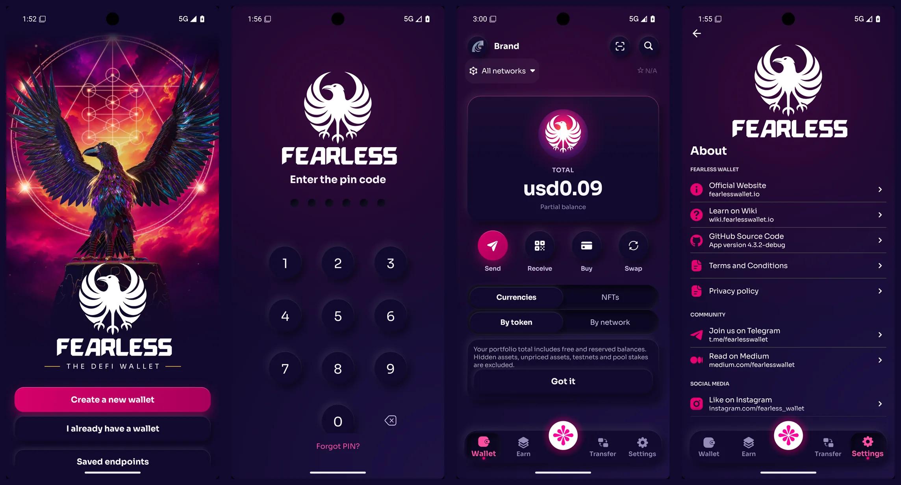

### Fearless Wallet Android
[](https://play.google.com/store/apps/details?id=jp.co.soramitsu.fearless) [](https://github.com/soramitsu/fearless-Android/actions/workflows/android-ci.yml)



## About
Fearless Wallet is a mobile wallet designed for the decentralized future on the Kusama network, with support on iOS and Android platforms. The best user experience, fast performance, and secure storage for your accounts. Development of Fearless Wallet is supported by Kusama Treasury grant.

[](https://twitter.com/FearlessWallet)

## Roadmap
Fearless Wallet roadmap is available for everyone: [roadmap link](https://soramitsucoltd.aha.io/shared/97bc3006ee3c1baa0598863615cf8d14)

## Dev Status
Track features development: [board link](https://soramitsucoltd.aha.io/shared/343e5db57d53398e3f26d0048158c4a2)

## Architecture & Current State
- Architecture overview: see `docs/ARCHITECTURE.md` for module layout, layers, and flows.
- Module map: see `docs/MODULES.md` for a quick feature-by-feature guide.
- Current state: see `docs/CURRENT_STATE.md` for supported ecosystems, integrations, and TODO hotspots.
 - Status snapshot: see `docs/status.md` for health, risks, and what’s incomplete.
 - Roadmap: see `docs/roadmap.md` for prioritized, actionable tasks.
 - Release process: see `docs/releases/PROCESS.md` for beta → stable steps and checklists.

## How to build

To build Fearless Wallet Android project, you need to provide several keys either in environment variables or in `local.properties` file:

### Moonpay properties
```
MOONPAY_TEST_PUBLIC_KEY=stub
MOONPAY_PRODUCTION_PUBLIC_KEY=stub
```

MoonPay purchases require valid keys; stub keys let you build and use the other parts of the application.
The Android artifact accepts only MoonPay publishable keys. It intentionally
does not prefill `walletAddress`, because MoonPay requires that parameter to be
signed by a backend-held API secret. Never add a MoonPay secret or client-side
URL signing to the app. See MoonPay's
[widget signing guidance](https://dev.moonpay.com/docs/off-ramp-web-sdk#signing).

### Buy provider partner properties
```
RAMP_TOKEN_DEBUG=stub
RAMP_TOKEN_RELEASE=stub
COINBASE_APP_ID=stub
```

Partner identifiers are loaded from `local.properties` or environment variables
so public builds do not require committed release config.

### Google Drive backup sign-in (no Firebase, no Play services)

The app's own code uses no Google Play services, Play Core, Firebase, `googleid`
or Google API client library, and no `google-services.json` is processed (the
Firebase Messaging and Play services libraries still in the release graph come
only from the Reown WalletConnect SDK). Google Drive wallet backup signs in with the app's
own OAuth 2.0 authorization-code flow with PKCE (S256) in the user's browser
(`core-backup` `oauth/`, screens in `feature-account-impl` `google_signin/`) and
talks to the Drive v3 REST API over OkHttp (`core-backup` `GoogleDriveApi`). The
refresh token is kept only in the app's encrypted preferences; access tokens
live in memory. Backups keep the layout every earlier version, iOS and the
browser extension use: `<address>.json` files of type `text/json` in the
`backupFolder` folder of the Drive app data space.

```
# Optional. Unset means project 621183184145's public iOS client, whose
# custom-scheme redirect Google accepts from Android with PKCE.
GOOGLE_DRIVE_OAUTH_CLIENT_ID=621183184145-....apps.googleusercontent.com
```

The client must belong to Cloud project 621183184145, where existing backups
are kept; the build refuses any other. The redirect scheme is the reversed
client id. `.github/release/android-google-drive-web-client-sha256.txt` pins the
client's SHA-256 for the release verifier. No `google-services.json` may exist
under `app/`: the public-artifact audit and the IAS build refuse one.

### Play testing releases

CI does not mutate Google Play. The `Android Signed Release Artifact` workflow
produces the only approved upload artifact through three fresh-runner jobs:

1. credential-free `release-controls` validates the signed tag, exact
   `master` source tree, prior CI, governance, and adversarial release suites;
2. `release-build` (`android-release-build`) restores no credential, runs the
   exact CI-only/source-bound unsigned `:app:bundleRelease`, and uploads an
   exact, individually attested four-file unsigned artifact: AAB, checksum,
   provenance, and the bounded verified Gradle/R8 build log;
3. `release-signing` (`android-release-signing`) downloads and revalidates
   those four files, their digests, source, provenance, and attestations before
   restoring the upload key. It signs with the certificate-pinned standalone
   signer, verifies identity, native payloads, and permissions from the signed
   bytes, and uploads a separately attested three-file final artifact.

Release dispatch remains fail-closed until the sentinel in
`.github/release/android-tag-signer-fingerprints.txt` is replaced by the exact
reviewed OpenSSH Ed25519 `SHA256:...` fingerprint and the matching one-line
public key is stored, base64 encoded, in the
`ANDROID_RELEASE_TAG_SIGNER_PUBLIC_KEY_B64` repository variable.

The build and signing environments require disjoint, exact User reviewer
allowlists, so the artifact crosses two distinct environment approvals. Each
allowlist must contain at least one User; two or more provides additional
reviewer redundancy. No Play service-account credential, Android Publisher API
client, or Gradle Play publishing task belongs in this workflow. An authorized
operator downloads the final workflow artifact and uploads its AAB manually to
the existing `beta`/Open Testing track, preserving the existing country and
tester configuration. See `docs/releases/PROCESS.md` for the evidence and Play
Console checklist.

### Internal App Sharing smoke builds

> [!WARNING]
> The Internal App Sharing (IAS) bundle is Android-debug-signed and Google
> re-signs IAS uploads. It cannot upgrade a wallet installed from Google Play.
> Never uninstall a funded wallet to install an IAS build. A fresh IAS install
> does **not** validate a production database migration or production release
> signing.

IAS is a file-only, pre-release smoke-test lane. Its Gradle variant deliberately
preserves the release shrinker, resources, package name, version code, and
manifest semantics, adds only the `-ias` version-name suffix, and emits an
unsigned quarantine AAB. A separate fresh-runner qualifier externally signs
those exact bytes with a run-bound ephemeral JKS whose certificate has the
Android Debug identity. It is not an alternative production release path, and
its signer is not a production trust anchor.

Only CI may create the artifact, from a clean checkout whose `HEAD` exactly
matches the lowercase 40-character `RELEASE_COMMIT`. Pull-request runs are
non-distributable validation only: they build and inspect the candidate on the
runner but create no handoff and upload no artifact. The sole eligible handoff
comes from a manual run in the first-party `soramitsu/fearless-Android`
repository after the reviewed change is merged to the protected `master`
branch and the checked-out commit is still the remote `master` head.

The protected invocation is exactly
`:app:bundleInternalAppSharing --no-build-cache --rerun-tasks`; combining it
with another Gradle task, using an unqualified/alternate task, supplying
release-signing inputs, or supplying Play/Firebase distribution credentials
fails closed. CI also binds the original runtime import provenance and complete app source tree.

IAS builds carry no Firebase or Google Services configuration: Gradle fails if a
`google-services.json` exists under `app/` or a Google Services task is
registered, and the AAB verifier fails if Firebase resources are compiled in.
The build never creates, copies into, owns, or cleans an
`app/src/internalAppSharing` tree; that path must remain absent. IAS can qualify
install/fresh launch, cold start, onboarding, navigation, local-only
disposable-wallet flows, and screens that need no production service. Google
Drive sign-in no longer depends on the signing certificate, so IAS builds can
exercise Drive backup with a test account. IAS cannot qualify passkey backup
(compiled off), Play upgrade, production database migration, or production
signing.

Pull-request validation is also deliberately WalletConnect-secretless and
non-distributable. Only an eligible protected-`master` manual dispatch binds
`secrets.FL_WALLET_CONNECT_PROJECT_ID`, and only to the exact non-cached bundle
step; that step fails closed unless it is 32 hexadecimal characters. The
project ID is never printed. Trusted tester acceptance must scan a valid `wc:`
pairing URI in addition to the cold-start/navigation soak.

Each eligible manual run transfers the exact unsigned producer artifact by
GitHub artifact ID and digest into a fresh qualifier. Disposable operating
system users independently validate the unsigned bytes, create a mode-`0600`
JKS, externally sign the candidate, export only its public certificate, and are
terminated at each trust-boundary transition. The private key is erased before
post-sign verification; it is never stored in the repository, transferred to
the handoff, or reused between runs.

Qualification must run `scripts/test-android-internal-app-sharing.sh`, build the
AAB, and then run `scripts/verify-android-internal-app-sharing-aab.sh` plus
`scripts/test-android-internal-app-sharing-aab.sh` against those exact bytes.
The artifact verifier checks the debug certificate and complete JAR signature,
embedded `RELEASE_COMMIT`, package/version/SDK identity, component and
permission surface, native payloads, and the absence of Firebase resources.
The supported verifier invocation is workflow-only under the workflow's
`CI=true` and source-bound `RELEASE_COMMIT`. Unsigned mode accepts no signer
input. Signed and `--signed-from` modes bind the checksum-pinned
`BUNDLETOOL_JAR`, exact uppercase
`EXPECTED_IAS_DEBUG_CERT_SHA256`, exactly one of the private
`ANDROID_IAS_DEBUG_KEYSTORE_PATH` or public-only
`ANDROID_IAS_DEBUG_CERTIFICATE_PATH`, and the exact `FEARLESS_UTILS_COMMIT`,
`FEARLESS_UTILS_EFFECTIVE_TREE` import-provenance receipt fields. Every mode may
write its private snapshot to one new absolute output path.

The identity harness also runs the exact extracted R8 fixture synthesizer
through 1 positive and 15 bounded negative/adversarial cases. The cases cover
source/output bytes, ZIP entry count, per-entry and aggregate expansion,
encrypted or unsupported entries, duplicate canonical metadata, symlinks, and
exclusive output creation.

The frozen suites must report dependency provenance 2 positive / 66
adversarial, bounded Gradle coverage cleanup 4 positive / 12
negative/adversarial, IAS Gradle 8 positive / 37 behavioral negative / 645
static adversarial assertions, and the workflow's Linux public-certificate IAS
AAB suite 7 positive / 78 adversarial artifacts. The AAB suite additionally
expects 7/76 in macOS certificate mode, 7/82 in macOS keystore mode, and 7/84
in Linux keystore mode. A changed total is a review event, not an automatic
pass.

Only the eligible first-party, post-merge `master` manual run may create a
handoff. The qualifier first uploads it with an explicitly pending/untrusted
name, downloads that exact archive back by immutable artifact ID and digest,
revalidates its bounded ZIP entries under another disposable user, and records
completion. A separate finalizer retains it for seven days only when every
qualification result and the current protected `master` head still match;
otherwise it deletes the artifact. A scheduled janitor removes canceled,
failed, stale, or ambiguous pending artifacts. Never use PR runner output.
After a successful run, an authorized operator may manually upload the exact
AAB in Play Console's Internal App Sharing page. The workflow has no Gradle
Play Publisher integration, uploads nothing to Google or Play, changes no Play
track, and consumes no Play service-account credential.

The handoff filename and verifier currently pin `4.3.5-ias` / version code
`237`. Any change to either value in `versioning/version.properties` must update
and review every IAS hardcode in the same commit before a new handoff is
eligible; never relabel old bytes with a new filename.

### Android testing distributions

For a fast manual Google Play Internal App Sharing build:

```
./gradlew :app:bundleInternalAppSharing
```

Upload
`app/build/outputs/bundle/internalAppSharing/app-internalAppSharing.aab` in Play
Console and share the generated IAS link. This explicit variant uses release
optimization/resources with the Android debug signer and a `-ias` version-name
suffix. It cannot be published by a normal Gradle Play Publisher task and is
not evidence for production signing, Play Integrity, certificate-bound app
links/passkeys, or production upgrade behavior.

Production-equivalent Google Play testing is handled by the tagged `Android
Release` workflow. It accepts only `internal`, `alpha`, or `beta`, defaults to
no Play publication and `draft`, and publishes the exact staged and attested
production-signed AAB. An Open Testing link additionally depends on Play Console
beta-track configuration and Google review. See
`docs/releases/PROCESS.md` for the required secrets, gates, and operator steps.

### Ethereum properties

Set of params required to deliver Ethereum connection

````
// Ethereum blast api nodes keys
FL_BLAST_API_ETHEREUM_KEY
FL_BLAST_API_BSC_KEY
FL_BLAST_API_SEPOLIA_KEY
FL_BLAST_API_GOERLI_KEY
FL_BLAST_API_POLYGON_KEY

// Etherscan V2 unified history key (Ethereum, BNB Smart Chain, Sepolia, Polygon)
FL_ANDROID_ETHERSCAN_API_KEY

// OP Mainnet history uses OKLink
FL_ANDROID_OKLINK_API_KEY

// Kaia mainnet and Kairos native/token history use KaiaScan OAPI
FL_ANDROID_KAIASCAN_API_KEY
````

## Local Validation

Run static analysis, unit tests, lint, and set up Android SDK packages:

```
bash scripts/validate-local.sh
```

Manual equivalents if you prefer:

```
./gradlew detektAll
./gradlew runTest
./gradlew :app:lint
```

Prerequisites: JDK 21 (Temurin/Adoptium) and Android SDK with API 36 + build-tools 36.0.0. The script will try to locate `ANDROID_SDK_ROOT` and install missing packages if `sdkmanager` is available.

### Android-owned runtime sources

This repository owns `runtime-utils`, `runtime-websocket`, `core-foundation`,
`core-ui`, `core-networking`, `core-chain`, `core-xcm` and `core-backup` as ordinary
Gradle projects. There is no sibling checkout, Git source dependency, published
internal Maven dependency, substitution or version override to configure.

The runtime import retains source/licenses from utils
`3d22dad159ca5304d199acd08c5a622dea3c1577` and WebSocket
`18a94e2db0f67a8387414bc7db53aac48ded18d7`.
`config/android-runtime-source-pins.json` records original Git provenance plus
SHA-256 for every owned source/build/native input. Edit these sources here and
review manifest changes in the same app commit. CI verifies the inventory before
and after Gradle. The release source guard binds the complete app commit/tree.
The owned Ed25519 verifier additionally incorporates the canonical-signature guard
and regression tests from reviewed Utils PR154 (`db86fdf14ba0d32a28df70ef97406f7317150b06`).
Signing bytes and native artifacts are unchanged; the manifest retains original
import provenance and hashes the current owned files.
Run `python3 scripts/generate-avatar-brand.py` to reproduce `CrestClip.kt`, the
wallet avatar's luminance mask, from the checksum-pinned Yatagarasu crest badge in
`brand/yatagarasu` (see its README for the brand kit). Its output path targets
`runtime-utils`.

```
python3 scripts/test-android-runtime-source-pins.py
bash scripts/verify-android-runtime-sources.sh
python3 scripts/test-remote-config-signing.py
python3 scripts/test-owned-remote-config.py
python3 scripts/verify-owned-remote-config.py
./gradlew :app:assembleDebug
```

`remote-config/{production,development}` and `remote-config/assets` are Android
owned. Current URLs use this public repository's `master` branch; publish the
reviewed files on master before shipping the consuming app. Import revisions,
original and rewritten digests, route retirement, lcDOT correction and artwork
fallbacks are recorded in `config/remote-config-imports.json`. Historical migration
fixtures intentionally retain their original bytes. Existing installed clients
still require the old configuration host; do not remove it as part of migration.

### Native sr25519 library (built from source)

`libsr25519java.so`, which holds every sr25519 key operation (Polkadot, Kusama,
SORA), is compiled from `runtime-utils/native/sr25519` during the Gradle build;
the repository contains no prebuilt native library of its own. Install once:

```
# rustup from https://rustup.rs; rust-toolchain.toml then installs Rust 1.99.1
# with the four Android targets on first use
cargo install cargo-ndk --version 4.1.2 --locked
sdkmanager "ndk;30.0.16248370"
```

`./gradlew :app:assembleDebug` then runs `:runtime-utils:buildSr25519AndroidLibraries`
(all four ABIs, API 26, 16 KB page alignment) and fails if a binary differs from
`runtime-utils/native/sr25519/reproducible-build.json`. Unit tests of
`runtime-utils` load a host build of the same crate and are skipped, with the
reason, when cargo is missing. After an intended change to the crate, its
`Cargo.lock` or the toolchain, run `./gradlew :runtime-utils:recordSr25519NativeHashes`
and `./gradlew :runtime-utils:verifySr25519ReproducibleBuild`, and commit the
updated manifest with the runtime source pins.

Tracked native/vendor binary provenance is documented in
`docs/binary-provenance.md`.
Public dependency provenance and current Soramitsu artifact blockers are tracked
in `docs/public-dependency-audit.md`.
Validate both governance documents before release with:

```
bash ./scripts/test-public-dependency-upstream-delta-export.sh
bash ./scripts/export-public-dependency-upstream-delta.sh --output build/reports/public-dependency-upstream-delta
bash ./scripts/test-public-artifact-provenance-audit.sh
./scripts/audit-public-artifacts.sh --strict-provenance
```

## Contributing

- Contributor Guide: see [AGENTS.md](AGENTS.md) for project layout, commands, and conventions.
- Process & community details: see [CONTRIBUTING.md](CONTRIBUTING.md).

## License
Fearless Wallet Android is available under the Apache 2.0 license. See the LICENSE file for more info.
